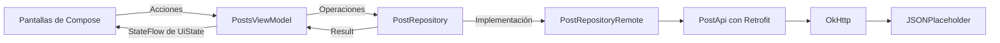
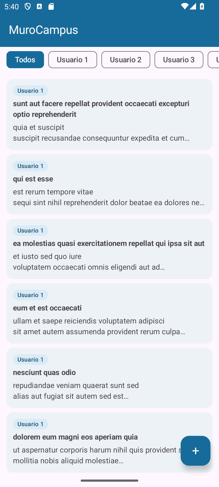
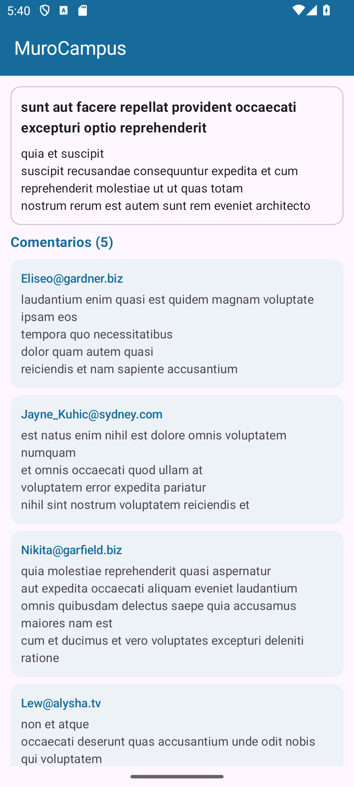
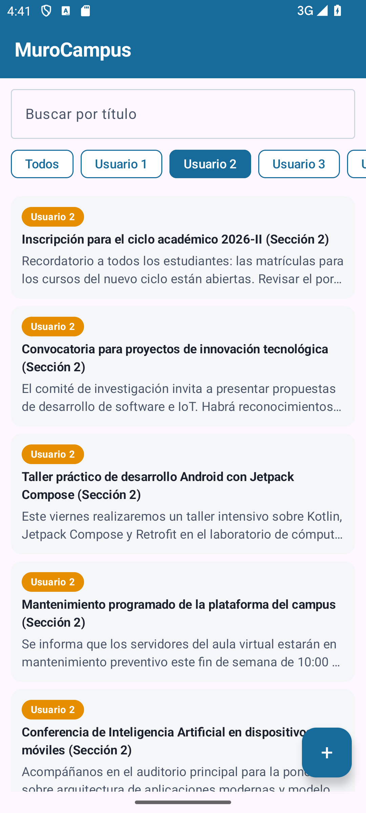
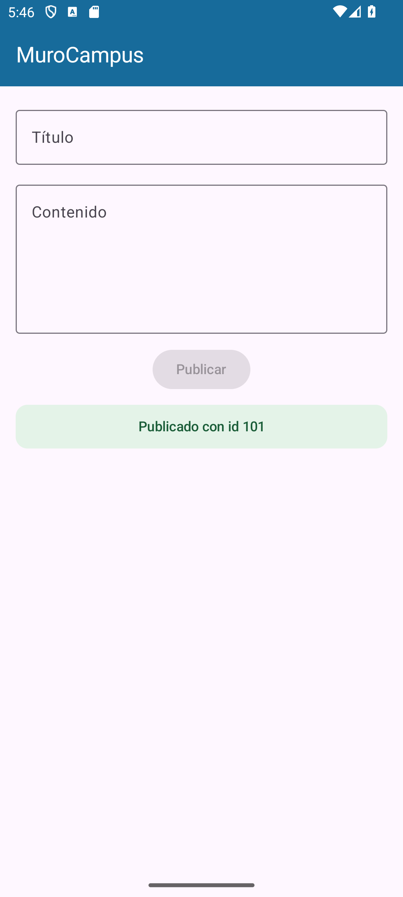
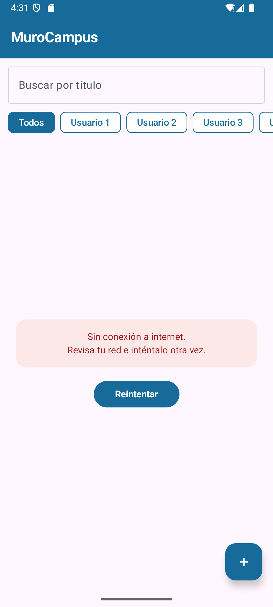
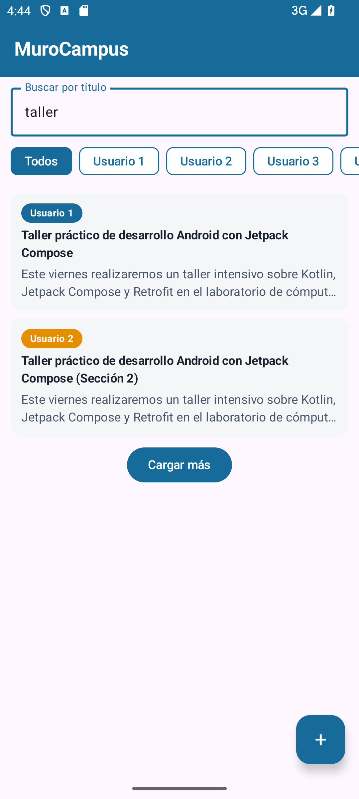
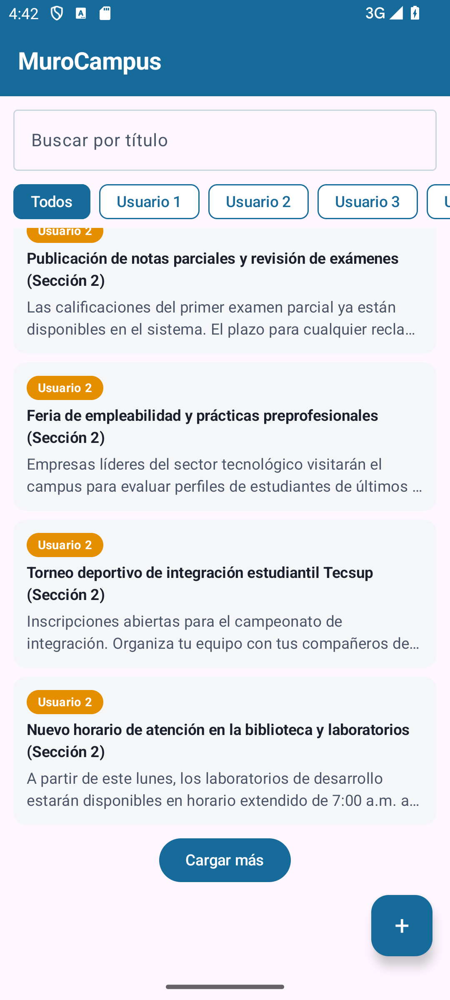

# MuroCampus

MuroCampus es una app Android hecha con Kotlin y Jetpack Compose. Consulta publicaciones y comentarios de JSONPlaceholder, filtra el muro por usuario y permite enviar una publicación de prueba. La pantalla muestra la carga, el resultado o un mensaje con **Reintentar** cuando falla una consulta.

## Ejecutar

1. Abre el repositorio en Android Studio y sincroniza Gradle.
2. Ejecuta el módulo `app` en un emulador o dispositivo Android con acceso a internet.
3. En Logcat, filtra por `okhttp.OkHttpClient` para ver las solicitudes y respuestas HTTP en la compilación de depuración.

## Estructura

```text
app/src/main/java/com/tecsup/murocampus/
├── MainActivity.kt
├── model/
│   └── Modelos.kt
├── data/
│   ├── MensajesDeError.kt
│   ├── PostRepository.kt
│   └── remote/
│       ├── PostApi.kt
│       └── RetrofitClient.kt
├── viewmodel/
│   ├── PostsViewModel.kt
│   ├── PostsViewModelFactory.kt
│   └── UiState.kt
└── ui/
    ├── Componentes.kt
    ├── PantallaCrear.kt
    ├── PantallaDetalle.kt
    ├── PantallaLista.kt
    └── theme/
        └── Theme.kt
```

## Arquitectura MVVM con Repository



La lista, el detalle y el formulario observan sus estados con `collectAsStateWithLifecycle()`. El ViewModel coordina las operaciones en corrutinas. El Repository devuelve `Result` y propaga la cancelación para que Atrás pueda interrumpir la carga del detalle.

## Capturas

Pantallas de la rama `mejora-ia`, capturadas en el emulador Android.

| Lista | Detalle | Filtro por usuario |
| :---: | :---: | :---: |
|  |  |  |

| Crear publicación | Error de conexión |
| :---: | :---: |
|  |  |

| Búsqueda por título | Paginación |
| :---: | :---: |
|  |  |

## Verificación de la Fase 1

| Prueba | Resultado observado |
| --- | --- |
| Sin internet | En modo avión aparece «Sin conexión a internet» y el botón **Reintentar**. |
| Reintentar | Al recuperar la conexión, **Reintentar** carga la lista. |
| Recurso inexistente | La consulta temporal a la publicación `9999` muestra «Error del servidor (404)». |
| JSON inesperado | Un campo extra del servidor se ignora. Si falta un campo obligatorio del modelo, aparece «Respuesta inesperada». |
| Cancelación | Volver rápido desde el detalle mantiene la lista y Logcat queda libre de errores de aplicación. |
| Lista y detalle | Tres publicaciones distintas muestran cinco comentarios cada una. |
| Filtro | Cada uno de los diez usuarios devuelve diez publicaciones del usuario elegido. |
| Crear | El POST devuelve HTTP 201 y el formulario muestra «Publicado con id 101». |
| Código | El ViewModel usa `PostRepository`. Los tipos de Retrofit quedan en la capa de datos. |

## Para pensar

1. **¿Qué diferencia hay entre GET y POST?** GET consulta datos. POST envía datos para que el servidor procese una operación, como crear una publicación. `crear` usa `@Body` para enviar `NuevoPost` como JSON en el cuerpo. `porUsuario` usa `@Query` para añadir `userId` a la URL de la consulta.
2. **¿Por qué la ruta es `posts`?** Retrofit resuelve `posts` de forma relativa a la URL base. Así conserva cualquier prefijo de esa base, como `/api/v1/`. Una ruta que empieza por `/` se resuelve desde la raíz del servidor.
3. **¿Por qué el Repository devuelve `Result`?** Así el ViewModel puede tratar el éxito y el fallo de cada operación mediante un contrato explícito y convertirlos en estados de interfaz. El Repository propaga `CancellationException` para que las corrutinas puedan cancelarse.
4. **¿Qué pasa si falta `INTERNET` o `ignoreUnknownKeys`?** El APK puede compilar sin el permiso, pero Android impide que la app abra conexiones de red. Con la configuración estricta de JSON, un campo agregado por el servidor puede provocar un error de deserialización. `ignoreUnknownKeys = true` permite aceptar campos adicionales. Los campos obligatorios del modelo siguen siendo necesarios.
5. **¿Por qué usar `when` sobre `UiState`?** La pantalla tiene un solo estado a la vez. El tipo sellado permite que Kotlin compruebe que el `when` cubre carga, éxito y error. Tres variables independientes permitirían combinaciones contradictorias.
6. **¿Qué cambiaría con un servicio real?** El servidor guardaría la publicación y devolvería su identificador definitivo. La app podría recargar el muro al recibir el éxito o añadir a la lista la publicación devuelta por el servidor, respetando el filtro activo. En JSONPlaceholder el guardado se simula y una nueva consulta conserva los datos de ejemplo.
